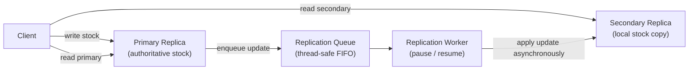

# Module 8: Replication & Consistency

## Project Overview

This project simulates a small replicated inventory system used to explore core distributed systems ideas: asynchronous replication, stale reads, replica recovery, and eventual consistency. A Primary replica accepts client writes and enqueues updates for a Secondary replica. A background replication worker applies those updates asynchronously. By pausing and resuming replication, the simulation shows how a Secondary can temporarily diverge and later converge without sharing mutable state between replicas.

## Architecture Diagram



## How It Works

- **Primary replica**: Owns the authoritative inventory value, accepts writes, serves reads, and enqueues each write for replication.
- **Secondary replica**: Stores an independent inventory copy, serves reads only, and is updated exclusively by the replication worker.
- **Asynchronous replication**: A background thread drains a FIFO queue and applies updates to the Secondary after a configurable simulated delay.
- **Stale reads**: Pausing replication blocks the worker from applying queued updates. The Primary can still accept writes, so a Secondary read can return an older value.
- **Pending updates**: While paused, updates remain in the queue (or held by the worker at a pause gate) and are not dropped.
- **Eventual consistency**: Resuming replication drains pending updates in order until both replicas converge.

This implementation simulates replicas inside a single Python process with threads. It is a teaching simulation, not a deployment of independent networked servers.

## Installation and Running Instructions

### Prerequisites

- Python 3.9 or newer
- No third-party dependencies are required (Python standard library only)

### Clone and run the demonstration

```bash
git clone <repository-url>
cd <repository-directory>
python main.py
```

On some systems you may need `python3` instead of `python`:

```bash
python3 main.py
```

### Run the automated tests

```bash
python -m unittest discover -s tests -v
```

or:

```bash
python3 -m unittest discover -s tests -v
```

## Evidence of Successful Replication

Captured from `python main.py` (also stored in [`evidence/demo_output.txt`](evidence/demo_output.txt)):

```text
=== Scenario 1: Successful Replication ===

Initial state:
Primary stock: 10
Secondary stock: 10

[WRITE] Primary stock updated to 12
[REPLICATION] Update queued
[REPLICATION] Secondary applied stock = 12

Primary read: 12
Secondary read: 12

[PASS] Both replicas contain the same value.
```

The Primary is updated immediately to `12`. After the asynchronous worker applies the queued update, the Secondary also returns `12`, demonstrating successful replication.

## Evidence of Stale Reads

```text
=== Scenario 2: Stale Read ===

[REPLICATION] Paused
[WRITE] Primary stock updated to 9
[REPLICATION] Update queued

Primary read: 9
Secondary read: 10

[STALE READ] Secondary has not received the latest update.
[PASS] Stale read successfully demonstrated.
```

Observed values:

- **Primary stock: 9**
- **Secondary stock: 10**

Replication was paused before the write, so the update remained pending. The Secondary was never manually set to `10`; it retained its previous independently stored value because the newest update had not yet been applied.

## Evidence of Recovery and Convergence

```text
=== Scenario 3: Recovery and Convergence ===

[REPLICATION] Resumed
[REPLICATION] Secondary applied stock = 9

Primary read: 9
Secondary read: 9

[PASS] Both replicas have converged.
[PASS] Eventual consistency successfully demonstrated.
```

After resume, the queued update propagated and **both replicas returned `9`**. The system recovered from temporary divergence and reached eventual consistency without rewriting Secondary state by hand.

## Results Summary

| Scenario | Primary | Secondary | Result |
|---|---:|---:|---|
| Initial state | 10 | 10 | Consistent |
| Successful replication | 12 | 12 | Consistent |
| Replication paused | 9 | 10 | Stale read |
| Replication resumed | 9 | 9 | Converged |

## Automated Testing

Run:

```bash
python -m unittest discover -s tests -v
```

The suite covers:

- Matching initial inventory on both replicas
- Primary writes
- Eventual propagation to the Secondary
- Pause / resume behavior
- Stale Secondary reads while paused
- Retention of pending updates
- Primary writability during pause
- Convergence after resume
- Ordered application of multiple queued updates
- Independent replica state
- Clean worker shutdown

Actual results (also in [`evidence/test_output.txt`](evidence/test_output.txt)):

```text
Ran 11 tests in 0.187s

OK
```

## Reflection

Reading quickly from a Secondary can reduce client latency and spread read load, but asynchronous replication means that Secondary may temporarily lag behind the Primary. In this simulation, pausing replication made that tradeoff concrete: the Primary immediately returned `9` while the Secondary still returned the stale value `10`. Guaranteeing the latest value requires reading from the Primary or waiting until replication completes, which can add latency and, in real systems, reduce availability if the Primary is unreachable. The recovery scenario then showed the complementary benefit of eventual consistency: after resume, both replicas converged to `9` without requiring synchronous replication on every write.

## Project Structure

```text
.
├── main.py                 # End-to-end demonstration of all 3 scenarios
├── inventory.py            # Primary and Secondary replicas
├── replication.py          # Async queue, worker, pause/resume, wait helpers
├── client.py               # Explicit primary/secondary client API
├── tests/
│   ├── __init__.py
│   └── test_replication.py
├── evidence/
│   ├── demo_output.txt
│   └── test_output.txt
├── README.md
└── .gitignore
```
